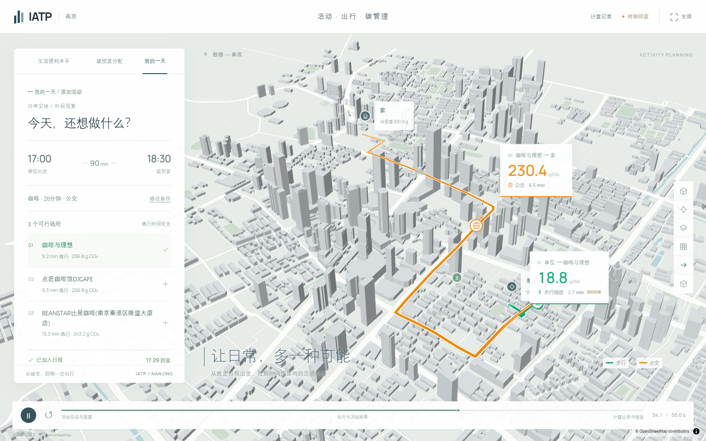
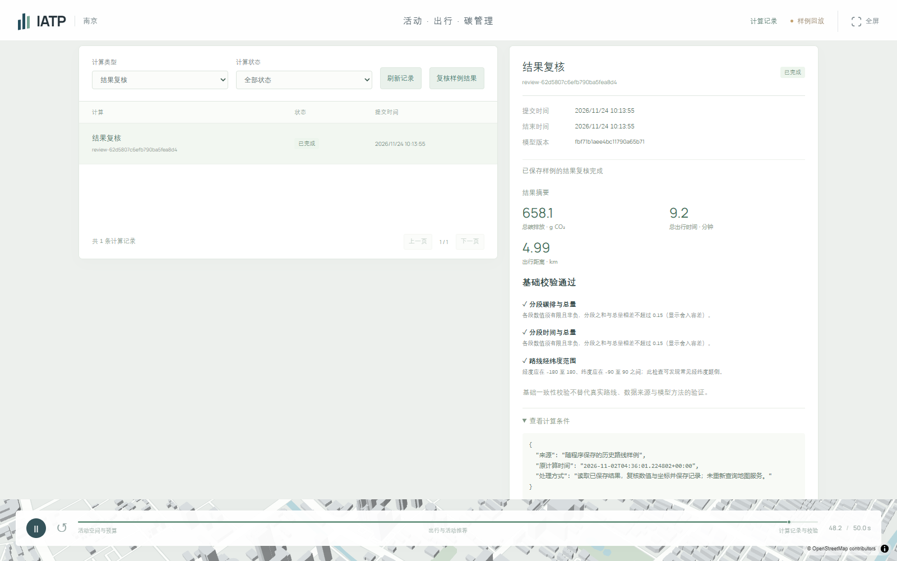
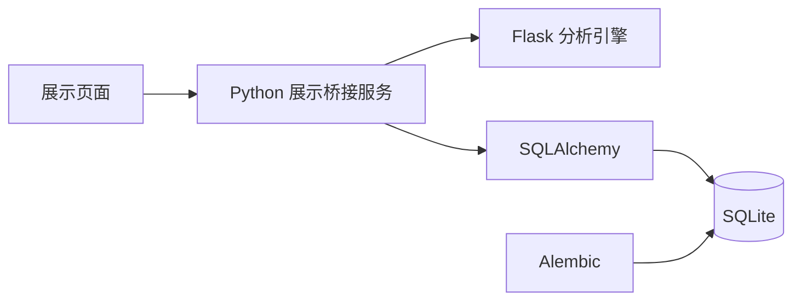

# IATP 活动出行与碳预算分析平台

面向日常活动与出行安排，分析活动空间、路线、时间及碳排放。后端包含 Flask 分析引擎，以及计算任务、结果缓存、历史记录和结果复核功能。

[观看 50 秒功能演示](assets/demo.mp4) · [计算记录接口](docs/API.md) · [开发指南](docs/开发指南.md) · [技术决策](docs/ADR.md)



## 功能

- 城市碳预算、活动空间、多方式出行与日程内场所推荐。
- 后台线程执行耗时任务，支持轮询、重复在途请求合并、超时反馈与协作取消。
- SQLAlchemy 与 SQLite 保存模型版本、任务和结果，支持分页、类型及状态筛选和参数详情。
- Alembic 管理初始数据库结构；pytest 验证记录、查询、取消和失败边界。
- 基础结果检查包括分段碳排与时间汇总、坐标范围及设施计数；检查不修改原始结果。



## 本仓库包含的内容

这是源码与样例展示仓库，保留 Python 分析代码、前端、桥接服务、迁移、测试和技术文档。完整 Electron/Python 桌面运行环境和大型路网、人口栅格、POI 原始数据不随 Git 仓库分发。

下方默认入口可以直接体验样例回放、已保存结果复核、真实数据库写入和历史查询，无需地图 Key。它不启动完整 Flask 计算引擎，也不将预计算样例冒充新发起的实时路线计算。

## 快速运行

建议使用 Python 3.11。Windows PowerShell 在仓库根目录运行：

```powershell
python -m venv .venv
.\.venv\Scripts\python.exe -m pip install -r requirements-dev.txt
.\.venv\Scripts\python.exe tools/run_demo.py
```

打开 `http://127.0.0.1:8890/`。点击播放查看 50 秒功能演示，或进入“计算记录”，点击“复核样例结果”，检查记录、参数及校验提示。

Linux 或 macOS 可以在创建虚拟环境后使用 `.venv/bin/python` 执行同样的安装与运行命令。

默认本地数据库位于 `.local/demo/history.sqlite3`，已加入忽略规则。首次运行执行 Alembic 迁移。重启会保留历史，并将上次未完成任务标为中断，不自动恢复执行。

## 运行测试

无需完整研究数据的后端测试：

```powershell
.\.venv\Scripts\python.exe -m pytest tools/test_history_store.py tools/test_bridge_history.py tools/test_result_checks.py -q -p no:cacheprovider
```

这些测试使用临时数据库与受控计算函数，不访问地图外网。原活动空间几何测试还需要 NumPy 和 Shapely，完整分析引擎的依赖声明位于 `resources/backend/requirements.txt`。

安装 Node.js 后可运行前端回归：

```powershell
node tools/test_player.cjs
node tools/test_activity_space_view.cjs
node tools/test_history_view.cjs
node tools/test_proxy.cjs
```

## 架构与数据模型



当前本地样例入口直接启动桥接服务；桌面版还使用 Electron 同源代理连接页面与 Python 服务。原 Flask 引擎源代码位于 `resources/backend/app.py`，完整运行需另外准备匹配的数据和服务配置。

| 表 | 内容 | 关联 |
| --- | --- | --- |
| model_versions | 计算程序与数据文件的版本标识 | 一个版本对应多次运行 |
| analysis_runs | 输入条件、任务状态和时间 | 每次运行关联一个版本 |
| analysis_results | 完整结果、摘要和部分结果标记 | 一次运行最多一条当前结果 |

历史列表通过三表关联读取摘要，详情再返回完整结果。版本标识当前依据文件元信息生成，不是完整的数据内容版本系统。

## 实现边界

- 样例回放使用已保存结果；“样例复核”执行真实复核、入库和查询，不重新请求地图服务。
- 原计算引擎存在共享状态，桥接层串行控制上游调用；后台线程不等于多用户高并发服务。
- 取消停止后续步骤，已发出的上游请求可能继续；服务重启后不支持断点续算。
- 当前没有登录、RBAC、MCP 或已验证的 PostgreSQL 集成。
- GitHub 展示源码不会自动托管 Flask 后端。部署静态页面时，也需要保留样例与实时计算的区分。

## 许可与来源

原平台软件著作权登记号为 2026SR1069086，著作权人为南京师范大学。本仓库不替第三方代码或研究数据授予额外许可；公开与再分发以各自权利范围为准。

前端附带的 MapLibre 与字体许可保留在 `editable-app/web/vendor/`。
