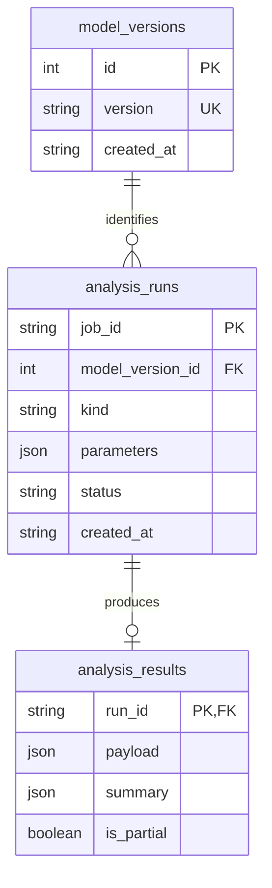

# 计算记录接口

计算记录接口位于展示桥接服务 `resources/bridge/service.py`，桌面代理将 `/api/` 转发到该服务。原 Flask 后端继续执行空间分析。前端通过 HTTP 读写业务，数据库访问集中在 `history_store.py`。

## 哪些操作会记录

| 请求 | 响应方式 | 类型 |
| --- | --- | --- |
| POST /api/showcase/route-chain | 同步返回结果，并附 historyId | route-chain |
| POST /api/showcase/activity-space | HTTP 202，返回 jobId 与 pollUrl | activity-space |
| POST /api/showcase/recommend-extra 且 async=true | HTTP 202，返回 jobId 与 pollUrl | recommendation |

输入沿用原展示功能，POST 请求体必须是 JSON 对象。默认样例回放不执行新的真实任务，也不会制造运行记录。

异步路径为：先保存输入和运行状态，再启动后台线程；前端通过 `GET /api/showcase/jobs/{jobId}` 轮询；结束后保存结果和终态。相同输入已有运行中的任务时复用编号，不重复创建记录。结束后再次提交会产生新的运行记录，计算缓存仍可能被命中。

## 分页列表

```text
GET /api/showcase/history?page=1&pageSize=10&status=completed&kind=route-chain
```

| 参数 | 含义 | 范围 |
| --- | --- | --- |
| page | 页码，默认 1 | 大于等于 1 的整数 |
| pageSize | 每页条数，默认 10 | 1 至 50 的整数 |
| status | 可选状态筛选 | running、completed、failed、cancelled、timed_out、interrupted |
| kind | 可选计算类型 | route-chain、activity-space、recommendation |

以下仅说明响应结构，数值并非预置的真实记录：

```json
{
  "success": true,
  "items": [{
    "jobId": "任务编号",
    "kind": "route-chain",
    "status": "completed",
    "stage": "计算完成",
    "modelVersion": "模型版本标识",
    "created_at": "ISO 8601 UTC 时间",
    "finished_at": "ISO 8601 UTC 时间",
    "summary": {"totalCarbonG": 12.0, "totalTravelMin": 8.0},
    "hasResult": true,
    "isPartial": false,
    "error": null
  }],
  "total": 1,
  "page": 1,
  "pageSize": 10
}
```

列表使用运行记录 JOIN 模型版本 LEFT JOIN 结果表，只读取摘要，不传输完整路线和 GeoJSON。没有符合条件的记录时，items 为 `[]`，total 为 `0`。

## 运行详情

```text
GET /api/showcase/history/{jobId}
```

成功返回 `{ "success": true, "run": {...} }`。run 包含 jobId、kind、status、modelVersion、parameters、summary、persisted=true，以及存在时的 result。已保存部分结果时，附 isPartial=true 和 partialResult。

run 中的 validation 是对已保存结果进行的轻量校验，不改写原始 result，也不另外创建校验表。路线检查分段碳排与时间之和是否与总量一致，使用 0.15 的舍入容差，并检查坐标范围；活动空间检查几何与类别数值。推荐结果暂不做这些校验。校验通过仅表示满足本项目约定的一致性规则，不证明模型或外部路线本身准确。

| 情况 | HTTP 状态 |
| --- | --- |
| 查询成功 | 200 |
| 页码、筛选条件或请求体无效 | 400 |
| 记录编号不存在 | 404 |
| 无法完成服务请求 | 502 |

失败响应为 `{ "success": false, "message": "原因" }`。参数应按接口要求提交，不拼接 SQL。地图服务 URL 中的 key、token 等查询参数在记录前脱敏。

首次保存输入失败时不启动任务。计算已执行后的保存失败不应改变计算本身的成功或失败状态，响应可带 historyWarning 提醒记录尚未保存；刷新任务可重试保存。历史查询是否成功仍取决于数据库当时是否可读。

## 生命周期

```text
running → completed / failed / cancelled / timed_out
服务重启时，上次未结束的 running → interrupted
```

数据库保护终态：完成、取消、超时等状态不会被迟到的 running 或另一种终态改写。完整结果也不会被迟到的部分结果覆盖。

取消接口是 `POST /api/showcase/jobs/{jobId}/cancel`。它停止后续步骤并保留已完成的部分结果，无法保证已经发出的底层 HTTP 请求立即终止。重启前的历史任务不恢复执行，重新分析会创建新编号。

## 表结构



一个版本关联多次运行，一次运行最多关联一个当前结果。结果单独保存，避免在状态快照中重复保存大块几何。Alembic 另有 alembic_version 技术表，用于记录结构迁移版本。

当前数据库没有用户身份表或权限表；记录编号也不是访问授权机制。本地展示适用这一范围，若改成公网服务，需要另外设计身份、数据归属和权限校验。

## 样例结果复核

POST /api/showcase/review-sample，JSON请求体为{}。读取程序自带的历史路线结果，保存为result-review类型，返回historyId。相同模型和样例重复复核复用同一条记录。参数中保留原计算时间和“未重新查询地图服务”的来源说明，详情返回真实一致性校验。该入口可在没有地图Key时演示持久化与查询。
