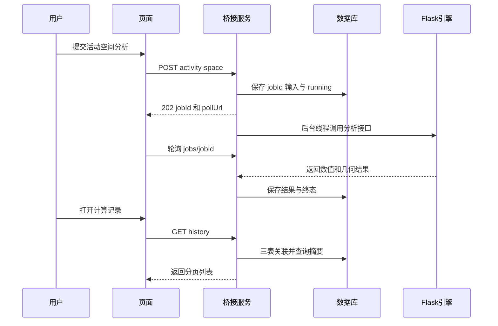

# 计算记录模块开发指南

本次增加的功能可以用一句话说明：用户提交一次分析，系统先记录条件和模型版本，再执行原计算，最后保存状态与结果，方便回看和排查问题。学习时先跟踪一条完整数据流，再看表关系、事务、线程与迁移。

## 一次计算如何经过系统



同步路线计算也保存记录，只是先算完再响应。自动故事回放读取已有样例，不代表刚刚执行了一次计算，因此不生成运行记录。

## 先掌握五个概念

| 概念 | 在本项目中的意思 | 应能说明的例子 |
| --- | --- | --- |
| 关系型数据库 | 用表和关联保存运行、版本及结果 | 一个版本为什么能对应多次运行 |
| ORM | 用 Python 类映射数据表，用表达式构建 SQL | AnalysisRun 对应 analysis_runs 表 |
| 事务 | 把相关修改作为一次提交，异常时回滚 | 创建运行时，版本关联与输入保存应一致 |
| 迁移 | 按版本升级表结构 | 新增列或索引属于迁移，新增运行属于业务写入 |
| 后台线程 | 把耗时计算放到请求之外执行 | HTTP 先返回 jobId，页面通过轮询等结果 |

ORM 不会替你理解 SQL；线程也不等于能安全并行运行共享计算器。

## 按函数阅读代码

1. 阅读 `resources/bridge/history_store.py` 中的 ModelVersion、AnalysisRun、AnalysisResult，画出三个表的关联。
2. 阅读 `HistoryStore.create_run`，找到 JSON 检查、事务、版本查询、输入保存和回滚边界。
3. 阅读 `resources/bridge/service.py` 的 new_job 与 recorded_route_chain，找到 HTTP 业务和数据库的连接点。
4. 阅读 `HistoryStore.save_snapshot`，解释为什么 cancelled 不能被迟到的 completed 改写。
5. 阅读 `HistoryStore.list_runs`，对照 JOIN 和 LEFT JOIN，解释没有结果的任务为何仍应显示。
6. 阅读 `resources/bridge/result_checks.py`，用一份路线结果手算分段总和，解释校验提示与原始结果的区别。
7. 阅读 `resources/bridge/migrations/versions/0001_analysis_history.py`，逐项对应数据模型中的表和索引。
8. 阅读 `tools/test_bridge_history.py` 的成功、失败与取消测试，把测试替身换成你能理解的小输入。

每读完一步，用自己的话说明输入、输出、失败方式。先能讲通，再尝试修改，不需要背下所有库的 API。

## 用 SQL 理解列表查询

ORM 查询表达的关系可以写为：

```sql
SELECT r.job_id, r.kind, r.status, v.version, x.summary
FROM analysis_runs AS r
JOIN model_versions AS v ON v.id = r.model_version_id
LEFT JOIN analysis_results AS x ON x.run_id = r.job_id
WHERE r.status = :status
ORDER BY r.created_epoch DESC, r.job_id DESC
LIMIT :page_size OFFSET :offset;
```

JOIN 表示每次运行必须对应模型版本。LEFT JOIN 保留没有结果的运行，例如正在执行或失败的任务。绑定参数把筛选值当成数据，不把用户输入拼成 SQL。分页偏移是 `(page-1)*page_size`，所以第一页偏移为零。

结果独立成表，可以让列表只读取摘要，详情再读取完整路线和 GeoJSON。不要把大块几何重复塞进每次状态快照。

## 五个动手练习

### 练习一 对照真实输入与记录

在“我的一天”修改出行方式，或重新提交活动空间计算。打开“计算记录”，核对输入、时间、状态和模型版本。若缺少 Key 导致失败，记录应说明失败，而不是生成假的成功结果。

查看一致性校验提示，手动计算一条路线的分段碳排和时间之和。0.15 的容差只处理显示舍入差异，不是在证明出行模型准确。修改测试输入让总量明显不一致，应得到“需检查”，原始结果仍保持不变。

完成标准：你能从页面定位到 jobId，再定位到 analysis_runs 和 analysis_results 的关联。

### 练习二 区分重复任务与缓存

同一异步请求正在运行时再次提交，观察复用的编号。任务结束后再提交，新的运行编号可能读取已有计算缓存。

完成标准：你能解释“请求正在执行所以复用任务”和“新任务命中了缓存”是两个不同机制。

### 练习三 理解取消

发起一个耗时任务后取消，查看状态和部分结果。对照 check_cancel、cancel_job 与 save_snapshot，找到协作取消的检查位置。

完成标准：你能解释为什么已经发出的上游请求可能继续，以及为什么迟到结果不能把取消改成完成。

### 练习四 验证重启

关闭并重新启动本版本，再查看历史。已保存记录仍在；未完成的运行标为 interrupted，重新计算使用新编号。

完成标准：你能说明“记录留存”和“任务恢复执行”的区别，知道当前没有断点续算。

### 练习五 修改一个测试

先运行 README 中的 pytest 命令，再阅读 test_route_chain_is_saved_and_listed。把受控结果中的碳排数值改掉，调整断言并重跑；接着让计算替身抛异常，检查状态是否为 failed。

完成标准：你知道测试的临时数据库在哪里创建，知道计算替身验证了什么，也知道它不能证明地图外网一定可用。

## 设计问题与解释

**为什么选择 SQLite？** 这是本地桌面展示，SQLite 免安装且便于复现，已经能练习真实的表关系、事务和多表查询。PostgreSQL 是后续独立验收项。

**为什么不用一个 JSON 文件保存全部记录？** 文件可以保存结果，但按状态、类型分页查询以及维护版本关联更适合数据库；事务也能让相关修改一起成功或失败。

**Alembic 做什么？** 它记录数据库结构版本并执行升级。创建一条分析记录是 INSERT，新增表或索引才是 schema migration。启动 upgrade 不会每次清空重建数据库。

**多个线程能共用一个 Session 吗？** 本项目不共用。每个数据库方法自己创建并关闭 Session，engine 负责连接管理。

**为什么还要对引擎加锁？** 原引擎有共享计算器和结果状态，单纯换线程或加任务队列不会解决状态相互覆盖。当前先串行控制上游调用。

**如何证明自己理解？** 用一次真实输入展示页面、接口、三个表、迁移和测试；解释失败、取消与重启路径，再现场修改一个小断言并运行验证。

**数据库保存失败等于计算失败吗？** 不等于。首次输入记录无法建立时不启动计算；已经算出的结果在短暂写库失败时仍可返回，同时提示 historyWarning，后续重试保存。这两个失败发生在不同阶段。

